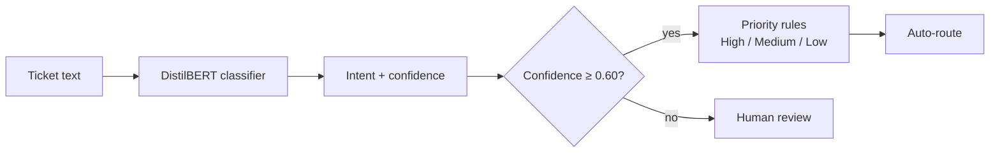

````markdown
# 🎫 TicketIQ: Support Ticket Intent Classifier

[](https://github.com/Saikot313/ticketiq-support-ticket-classifier/actions/workflows/ci.yml)


A fine-tuned **DistilBERT (PyTorch)** model that reads a customer-support message, identifies **what the customer wants** (77 intents), assigns a **priority** (High / Medium / Low), and **flags low-confidence tickets for a human agent**. Served through a **FastAPI** service and a **Streamlit** UI, so workflow-automation tools (n8n, Zapier, Make) can call it directly.

## Example

**Input:** `My card was stolen and I see payments I did not make`

| Field | Value |
|---|---|
| `intent` | `lost_or_stolen_card` |
| `confidence` | 0.97 |
| `priority` | **High** |
| `needs_human_review` | `false` |

Messages the model is unsure about (e.g. random text) fall below the confidence threshold and are routed to a human.

<!-- Add a screenshot of the Streamlit app: save it as docs/streamlit_ui.png and uncomment the next line -->
<!--  -->

## Results

Evaluated on the official Banking77 test set (3,080 queries, 77 intents).

| Model | Accuracy | Macro-F1 | Top-3 accuracy |
|---|---|---|---|
| TF-IDF + Logistic Regression (baseline) | 0.8867 | 0.8872 | 0.9679 |
| **DistilBERT (fine-tuned)** | **0.9188** | **0.9185** | **0.9776** |


### Priority layer
| Metric | Value |
|---|---|
| Priority accuracy | 0.9627 |
| High-priority recall | 0.9250 |
| High-priority precision | 0.9506 |

### Confidence threshold: automation vs accuracy
| Threshold | Tickets handled automatically | Accuracy on those |
|---|---|---|
| 0.50 | 94.2% | 95.1% |
| **0.60 (default)** | **91.5%** | **96.0%** |
| 0.70 | 88.2% | 96.8% |
| 0.80 | 81.5% | 97.8% |
| 0.90 | 68.0% | 99.0% |

A higher threshold sends more tickets to humans but makes the automated decisions more reliable.

### Error analysis
Most mistakes come from near-duplicate intents that are ambiguous even for humans:

| True intent | Predicted as | Errors |
|---|---|---|
| `why_verify_identity` | `verify_my_identity` | 12 |
| `card_arrival` | `card_delivery_estimate` | 4 |
| `declined_transfer` | `declined_card_payment` | 4 |
| `exchange_charge` | `exchange_rate` | frequent in confident errors |

Full analysis: `reports/error_analysis.csv`, `reports/figures/top_confusions.png`, `reports/figures/confusion_matrix.png`.

## How it works



- **Model:** `distilbert-base-uncased` fine-tuned with a custom PyTorch loop (AdamW, linear warmup, gradient clipping, best checkpoint chosen by validation macro-F1).
- **Training setup:** 4 epochs, batch size 32, learning rate 5e-5, max length 64, stratified 90/10 train/validation split, fixed seed.
- **Priority rules:** `configs/priority_map.yaml` maps all 77 intents to a level (fraud and money-at-risk = High, transaction problems = Medium, how-to questions = Low). This is a business rule, not a learned label.
- **Human-review flag:** predictions below the confidence threshold set `needs_human_review: true`.

## Features
- Baseline vs transformer comparison, per-class report, confusion and error analysis
- Confidence-vs-coverage analysis to justify the automation threshold
- REST API: `/health`, `/predict`, `/predict/batch` (input validation, 503 when no model is loaded)
- Streamlit UI with priority colours, top-3 predictions and review warning
- Unit and API tests with pytest, GitHub Actions CI, Dockerfile
- Reproducible: fixed seeds, config-driven (`configs/config.yaml`), numbered pipeline scripts

## Project structure
```
├── configs/            config.yaml, priority_map.yaml
├── notebooks/          pipeline.ipynb (runs the numbered scripts with %run)
├── scripts/            01_download_data.py … 05_api_smoke_test.py
├── src/ticketclf/      data, baseline, train, evaluate, predict, priority, api
├── tests/              priority, data and API tests
├── reports/            metrics.json, error_analysis.csv, figures/
├── app.py              Streamlit UI
├── Dockerfile          API container
└── .github/workflows/  CI (pytest)
```

## Quickstart

```bash
git clone https://github.com/Saikot313/ticketiq-support-ticket-classifier.git
cd ticketiq-support-ticket-classifier
python -m venv .venv
.venv\Scripts\activate          # Windows  (Linux/macOS: source .venv/bin/activate)
pip install -r requirements.txt
```

### 1. Run the pipeline
Open `notebooks/pipeline.ipynb` and run the cells in order, or run the scripts directly:

```bash
python scripts/01_download_data.py      # download Banking77, split, validate priority map
python scripts/02_train_baseline.py     # TF-IDF + Logistic Regression
python scripts/03_train_distilbert.py   # fine-tune DistilBERT (CPU ~20-40 min)
python scripts/04_evaluate.py           # metrics, plots, error analysis
python scripts/05_api_smoke_test.py     # end-to-end API check
```

### 2. Serve the API
```bash
uvicorn ticketclf.api:app --app-dir src --port 8000
```
Interactive docs: http://127.0.0.1:8000/docs

```bash
curl -X POST http://127.0.0.1:8000/predict \
  -H "Content-Type: application/json" \
  -d "{\"text\": \"My card was stolen and I see payments I did not make\"}"
```

```json
{
  "intent": "lost_or_stolen_card",
  "confidence": 0.97,
  "priority": "High",
  "needs_human_review": false,
  "top_k": [
    {"intent": "lost_or_stolen_card", "confidence": 0.97},
    {"intent": "compromised_card", "confidence": 0.01},
    {"intent": "card_swallowed", "confidence": 0.01}
  ]
}
```
(Values shown are illustrative.)

### 3. Streamlit UI
```bash
streamlit run app.py
```

### 4. Docker
```bash
docker build -t ticketiq .
docker run -p 8000:8000 ticketiq
```

### 5. Tests
```bash
pytest -q
```

## Limitations
- Trained on public **banking** queries in **English** only. Real support tickets from another domain need domain-specific fine-tuning.
- Priority levels are hand-written business rules, not learned from labelled urgency data.
- About 7.5% of truly high-priority tickets are not predicted as High. The human-review threshold reduces this risk but does not remove it.
- Several intents overlap heavily (see error analysis), which caps achievable accuracy on this dataset.

## Roadmap
- [ ] n8n workflow that calls `/predict` and routes tickets to Slack / Google Sheets by priority
- [ ] Fine-tune on domain-specific tickets and add multilingual support
- [ ] Calibrate confidence scores (temperature scaling)

## Data and citation
[Banking77](https://github.com/PolyAI-LDN/task-specific-datasets) (CC BY 4.0):
Casanueva et al., 2020, *Efficient Intent Detection with Dual Sentence Encoders*.

## Author
**Md. Sakender Saikot**: [GitHub](https://github.com/Saikot313)
````
