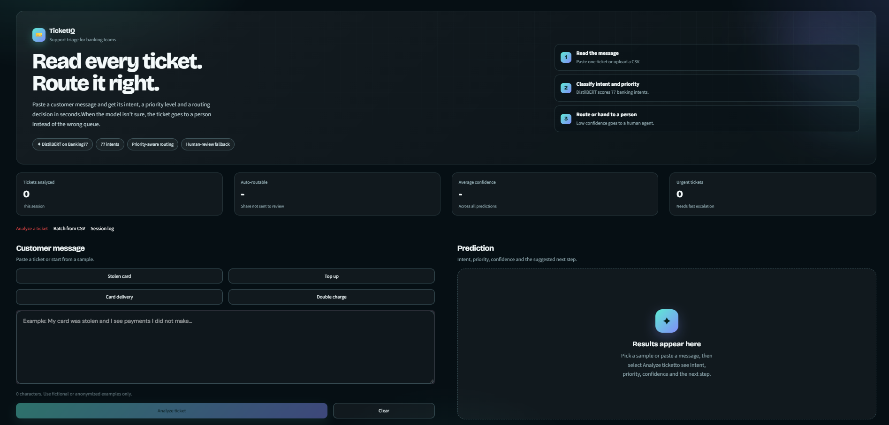
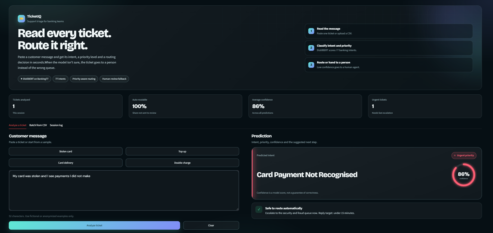
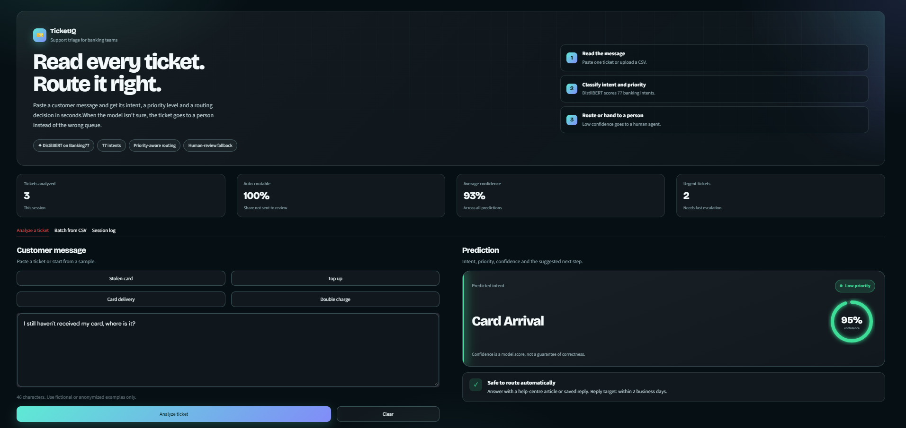
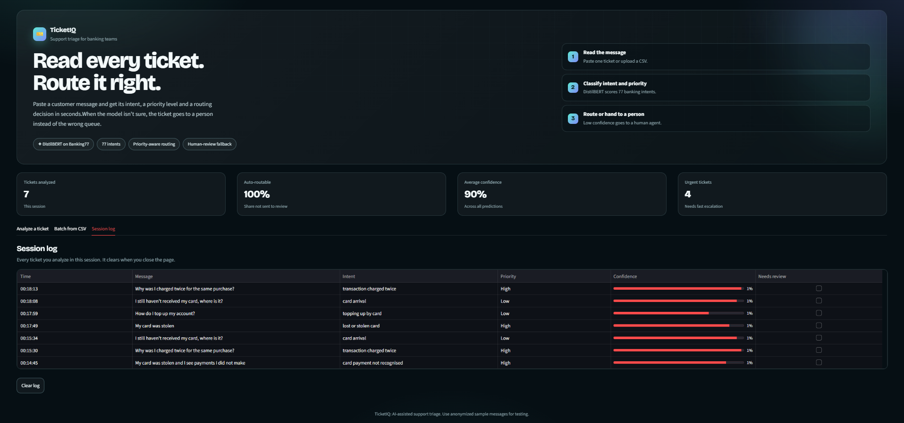
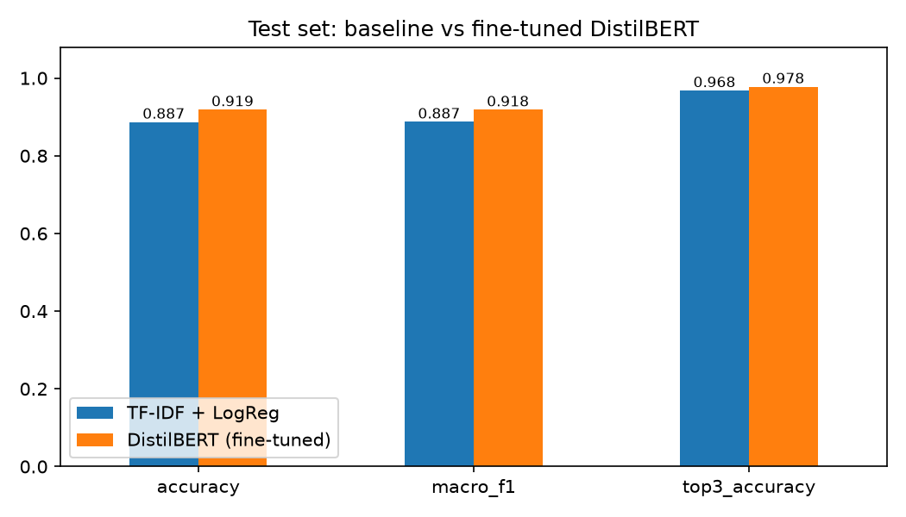
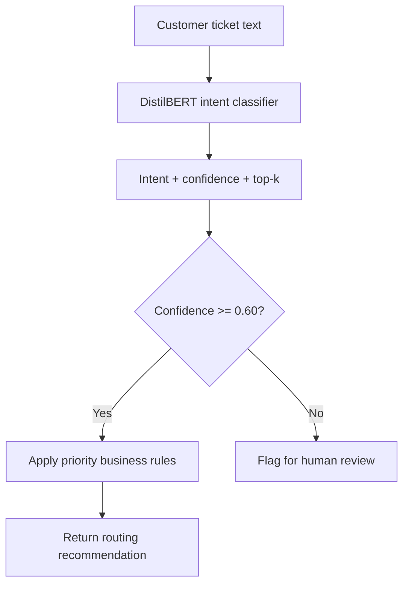

# 🎫 TicketIQ: Support Ticket Intent Classifier

[](https://github.com/Saikot313/ticketiq-support-ticket-classifier/actions/workflows/ci.yml)


TicketIQ is an AI-assisted support-ticket classification system. It uses a fine-tuned **DistilBERT (PyTorch)** model to identify what a customer is asking about across **77 banking-support intents**, assign a rule-based priority, and flag low-confidence predictions for human review.

The project includes a **FastAPI REST API**, a **Streamlit dashboard**, a TF-IDF + Logistic Regression baseline, evaluation and error-analysis scripts, tests, Docker support, and GitHub Actions CI. The API can be called by workflow-automation tools such as n8n, Zapier, or Make.

> **Dataset scope:** Banking77 contains English-language banking queries. Priority levels are assigned by configurable business rules, not learned from urgency-labelled examples. Use fictional or anonymized messages for demos.

---

## ✨ Key Features

- **77-intent classification** with a fine-tuned DistilBERT model.
- **Baseline comparison** against TF-IDF + Logistic Regression.
- **Priority-aware routing** using a configurable intent-to-priority map.
- **Confidence threshold** to flag uncertain predictions for human review.
- **Top-k predictions** to help inspect alternative intent labels.
- **Batch prediction** endpoint for processing multiple tickets.
- **Streamlit UI** for single-ticket analysis, CSV batches, and session history.
- **Evaluation and error analysis**, including confusion matrices and common intent confusions.
- **REST API** with input validation and a health endpoint.
- **Automated tests and CI** using pytest and GitHub Actions.
- **Dockerfile** for containerizing the API.
- **Reproducibility controls**, including fixed seeds and configuration files.

## 🖥️ Screenshots

### 1. User Interface

The main TicketIQ dashboard for entering a customer message, choosing sample tickets, and reviewing the model's prediction.



### 2. Test One

Example test case showing an analyzed ticket, predicted intent, confidence score, and recommended routing action.



### 3. Test Two

A second example demonstrating how a different ticket intent is classified and presented in the dashboard.



### 4. Session Log

The session log lists analyzed messages, predicted intents, priorities, confidence scores, and human-review flags for the current app session.



---

## 📊 Model Results

Evaluated on the official Banking77 test set (**3,080 queries across 77 intents**).

| Model | Accuracy | Macro-F1 | Top-3 Accuracy |
|---|---:|---:|---:|
| TF-IDF + Logistic Regression (baseline) | 0.8867 | 0.8872 | 0.9679 |
| **Fine-tuned DistilBERT** | **0.9188** | **0.9185** | **0.9776** |

### Priority-layer results

| Metric | Value |
|---|---:|
| Priority accuracy | 0.9627 |
| High-priority recall | 0.9250 |
| High-priority precision | 0.9506 |

### Confidence threshold: automation vs. accuracy

| Threshold | Tickets handled automatically | Accuracy on automatically handled tickets |
|---|---:|---:|
| 0.50 | 94.2% | 95.1% |
| **0.60 (default)** | **91.5%** | **96.0%** |
| 0.70 | 88.2% | 96.8% |
| 0.80 | 81.5% | 97.8% |
| 0.90 | 68.0% | 99.0% |

A higher confidence threshold sends more tickets to human review, while improving accuracy among the tickets that are handled automatically. These results describe this evaluation setup and should not be treated as a guarantee of real-world performance.

### Common classification confusions

| True intent | Predicted as | Errors |
|---|---|---:|
| `why_verify_identity` | `verify_my_identity` | 12 |
| `card_arrival` | `card_delivery_estimate` | 4 |
| `declined_transfer` | `declined_card_payment` | 4 |
| `exchange_charge` | `exchange_rate` | Frequent in confident errors |

Detailed outputs are saved under `reports/`, including error-analysis data and figures.



---

## ⚙️ How It Works



1. The user submits a message through the Streamlit interface or API.
2. The classifier predicts one of 77 intent labels and a confidence score.
3. The configured confidence threshold determines whether the prediction is flagged for review.
4. If it meets the threshold, a separate business-rule map assigns High, Medium, or Low priority.
5. The result includes the intent, confidence, priority, human-review flag, and top-k predictions where applicable.

### Model and training setup

- **Base model:** `distilbert-base-uncased`
- **Framework:** PyTorch, using a custom training loop
- **Optimizer:** AdamW with linear warmup and gradient clipping
- **Training configuration:** 4 epochs, batch size 32, learning rate `5e-5`, maximum sequence length 64
- **Validation:** stratified 90/10 training/validation split
- **Checkpoint selection:** best validation macro-F1
- **Reproducibility:** fixed seed and configuration-driven settings

### Priority and human-review logic

- `configs/priority_map.yaml` maps the 77 intents to a priority level.
- Fraud and money-at-risk intents are mapped to High; transaction problems to Medium; how-to questions to Low, according to the configured rules.
- The priority layer is **rule-based**, not trained on labelled urgency data.
- Predictions below the configured confidence threshold set `needs_human_review: true`.

---

## 🔌 API

The FastAPI service provides these endpoints:

| Endpoint | Purpose |
|---|---|
| `GET /health` | Health check |
| `POST /predict` | Classify one ticket |
| `POST /predict/batch` | Classify a batch of tickets |

The API validates input and returns a `503` response if no model is loaded.

### Example response

The values below are illustrative, not a guaranteed output for every run.

```json
{
  "intent": "lost_or_stolen_card",
  "confidence": 0.97,
  "priority": "High",
  "needs_human_review": false,
  "top_k": [
    {"intent": "lost_or_stolen_card", "confidence": 0.97},
    {"intent": "compromised_card", "confidence": 0.01},
    {"intent": "card_swallowed", "confidence": 0.01}
  ]
}
```

### Example API request

```bash
curl -X POST "http://127.0.0.1:8000/predict" \
  -H "Content-Type: application/json" \
  -d "{\"text\":\"My card was stolen and I see payments I did not make\"}"
```

Interactive API documentation is available at `http://127.0.0.1:8000/docs` after the API starts.

---

## 🗂️ Project Structure

```text
ticketiq-support-ticket-classifier/
├── configs/
│   ├── config.yaml
│   └── priority_map.yaml
├── notebooks/
│   └── pipeline.ipynb
├── scripts/
│   ├── 01_download_data.py
│   ├── 02_train_baseline.py
│   ├── 03_train_distilbert.py
│   ├── 04_evaluate.py
│   └── 05_api_smoke_test.py
├── src/ticketclf/
│   ├── data
│   ├── baseline
│   ├── train
│   ├── evaluate
│   ├── predict
│   ├── priority
│   └── api
├── tests/
├── reports/
│   └── figures/
├── screenshots/
│   ├── user-interface.png
│   ├── test-one.png
│   ├── test-two.png
│   └── session-log.png
├── app.py
├── Dockerfile
└── .github/workflows/ci.yml
```

---

## 🚀 Getting Started

### Requirements

- Python 3.10 or later
- Git
- Internet access for downloading the dataset and pretrained model
- Optional: Docker for containerized API execution

### 1. Clone the repository

```bash
git clone https://github.com/Saikot313/ticketiq-support-ticket-classifier.git
cd ticketiq-support-ticket-classifier
```

### 2. Create and activate a virtual environment

**Windows PowerShell**

```powershell
python -m venv .venv
.\.venv\Scripts\Activate.ps1
```

**Linux/macOS**

```bash
python -m venv .venv
source .venv/bin/activate
```

### 3. Install dependencies

```bash
python -m pip install --upgrade pip
pip install -r requirements.txt
```

### 4. Run the ML pipeline

Open `notebooks/pipeline.ipynb` and run the cells in order, or execute the scripts from the repository root:

```bash
python scripts/01_download_data.py
python scripts/02_train_baseline.py
python scripts/03_train_distilbert.py
python scripts/04_evaluate.py
python scripts/05_api_smoke_test.py
```

The DistilBERT training step may take considerably longer on CPU than on a compatible GPU. Runtime depends on hardware and environment.

### 5. Start the FastAPI service

```bash
uvicorn ticketclf.api:app --app-dir src --host 127.0.0.1 --port 8000
```

Open `http://127.0.0.1:8000/docs` to inspect and test the API.

### 6. Start the Streamlit dashboard

In a separate terminal, with the virtual environment activated:

```bash
streamlit run app.py
```

Streamlit will print the local URL to open in your browser.

### 7. Run tests

```bash
pytest -q
```

### 8. Run the API with Docker

Build the image:

```bash
docker build -t ticketiq .
```

Start the container:

```bash
docker run --rm -p 8000:8000 ticketiq
```

Then open `http://127.0.0.1:8000/docs`.

---

## 🔬 Evaluation and Error Analysis

The repository includes a baseline-versus-transformer comparison, per-class metrics, confusion-matrix visualizations, and error-analysis outputs. The analysis highlights near-duplicate or semantically overlapping labels, where a ticket can resemble more than one intent.

Review these generated artifacts after running the evaluation pipeline:

- `reports/metrics.json`
- `reports/error_analysis.csv`
- `reports/figures/model_comparison.png`
- `reports/figures/top_confusions.png`
- `reports/figures/confusion_matrix.png`

---

## ⚠️ Limitations

- The model is evaluated on public, English-language Banking77 queries, not live production tickets.
- The dataset is banking-domain specific; other industries may require domain-specific training or evaluation.
- Priority assignment uses hand-written business rules rather than labelled urgency data.
- The reported evaluation results do not guarantee production performance.
- Some intents overlap semantically and can be difficult to distinguish.
- The reported evaluation indicates that some truly high-priority tickets are not predicted as High; human review and operational safeguards remain important.
- Confidence scores are model outputs and should not be interpreted as guarantees of correctness.

---

## 🛣️ Roadmap

- [ ] Build an n8n workflow that calls `/predict` and routes tickets to Slack or Google Sheets by priority.
- [ ] Fine-tune and evaluate on domain-specific support tickets.
- [ ] Add multilingual support.
- [ ] Evaluate confidence calibration, including temperature scaling.
- [ ] Add end-to-end integration tests for downstream automation.

---

## 📚 Dataset and Citation

The project uses **Banking77**, a public dataset of banking customer-service queries.

- Dataset repository: [PolyAI task-specific datasets](https://github.com/PolyAI-LDN/task-specific-datasets)
- License stated for the dataset: CC BY 4.0
- Paper: Casanueva et al. (2020), *Efficient Intent Detection with Dual Sentence Encoders*.

Please consult the dataset repository and paper for the original dataset details and citation requirements.

---

## 👤 Author

**Md. Sakender Saikot**

- GitHub: [Saikot313](https://github.com/Saikot313)

---

*TicketIQ is a portfolio and demonstration project. Do not use it as the sole basis for real financial, fraud, or customer-impacting decisions without domain-specific validation, monitoring, and human oversight.*
